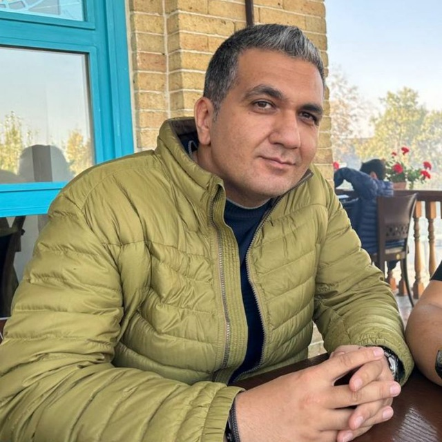

# Reza Bayat — Personal Website

A bilingual personal portfolio website built with HTML, CSS and vanilla JavaScript.

## Features

- Persian and English languages
- RTL / LTR support
- Light and dark themes
- Vazirmatn Persian typography
- Responsive editorial design
- Profile photo placeholder
- Django and DRF focused portfolio
- Editable social media links
- No build tools or JavaScript frameworks

## Project Structure

```text
reza-bayat-me/
├── index.html
├── README.md
└── assets/
    ├── profile-placeholder.svg
    └── profile.jpg
```

## Customize

### Profile photo

Place your image in `assets/profile.jpg`.

Update the image source in `index.html`:

```html

```

### Social media

Find the `social-links` section in `index.html`.

Replace placeholder URLs with your real profiles:

- GitHub
- LinkedIn
- Instagram
- Telegram
- X
- Email

### Portfolio projects

The project cards are concept examples, not claims of completed client work.

Replace their titles, descriptions, preview images and links with real projects.

### Personal information

Edit the hero section, services, technology stack and contact text directly in `index.html`.

## Run Locally

Open `index.html` in your browser.

For local development, you can also use:

```bash
python -m http.server 8000
```

Then visit:

http://localhost:8000

## Deploy with GitHub Pages

1. Push the project files to your GitHub repository.
2. Open repository Settings.
3. Navigate to Pages.
4. Select Deploy from a branch.
5. Select `main` and `/ (root)`.
6. Save.

Your website will be published through GitHub Pages after deployment completes.

## Technologies

- HTML5
- CSS3
- Vanilla JavaScript
- Google Fonts
